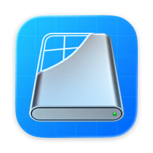

<h1 align="center">SwiftyDMG</h1>

Build DMG installers for your macOS apps with a native layout editor.

Drop in an `.app`, customize its disk image, and create an installer with an Applications shortcut, your own background, and a matching disk icon. SwiftyDMG brings the packaging workflow into a SwiftUI app with a live preview and detailed build logs.

## Features

- **A native workspace.** Start with a compact drop window that expands into an editor, with settings in the inspector and independent packaging windows.
- **An interactive preview.** Drag the app and Applications icons into place, adjust Finder window dimensions, and change preview zoom and appearance.
- **Custom artwork.** Use a default or custom background, generate a disk icon from the app, or choose your own icon. Both assets can also be omitted.
- **Flexible output.** Start with a filename based on the app's name and version, then customize the filename, save location, and mounted volume name.
- **Detailed build activity.** Follow individual steps, expand their command output, copy the complete log, and reveal the finished DMG in Finder.
- **Finder integration.** Open a selected app through the **Create DMG with SwiftyDMG** service.

## Roadmap

- [ ] Create disk images from any folder.
- [ ] Save and reopen packaging configurations for future app releases.
- [ ] Import and export reusable packaging presets.
- [ ] Add, remove, and organize files and folders in a contents sidebar.
- [ ] Sign DMGs directly in the app.

Have a packaging workflow you would like SwiftyDMG to support? Share your ideas and discuss roadmap priorities through [GitHub Issues](https://github.com/chocoford/SwiftyDMG/issues).

## Getting started

SwiftyDMG requires **macOS 14 or later**.

### Create a disk image

1. Drop an `.app` onto the welcome window, or click **Open…** to choose one.
2. Adjust the output, appearance, and Finder layout in the **Settings** inspector. Drag icons in the preview to change their positions.
3. Click the **play button** in the toolbar to create the DMG. Follow progress in the **Build** inspector, then use **Show in Finder** to locate the result.

Use **File → New Window** (⌘N) for another workspace, or **Open App…** (⌘O) to select another app. Settings currently belong to the window session.

The volume name controls the mounted disk's title; the output filename controls the `.dmg` file. They can be changed independently. The filename reset button restores the app's name and version.

Preview appearance changes the Finder window chrome and the **No Background** canvas. Background images keep their own colors when switching between light and dark appearances.

To use the Finder service, install SwiftyDMG in Applications and launch it once. Enable **Create DMG with SwiftyDMG** in System Settings if it does not appear in Finder's Services menu.

## Contributing

Bug reports, feature proposals, code, documentation, and translation improvements are welcome. See [CONTRIBUTING.md](CONTRIBUTING.md) for setup, reporting guidance, pull request expectations, and localization conventions.

To build SwiftyDMG locally, start with the [contributor setup](CONTRIBUTING.md#getting-started), then follow the [build and test instructions](CONTRIBUTING.md#build-and-test).

When reporting a packaging failure, include the steps to reproduce it, your macOS version, and the complete log from the Build inspector.

## Built with

SwiftyDMG uses SwiftUI and AppKit for its macOS interface, together with:

| Project | Role |
| --- | --- |
| [AppDMG](https://github.com/chocoford/AppDMG) | Disk-image creation and Finder layout |
| [hdiutil](https://github.com/chocoford/hdiutil) | Swift access to macOS disk-image commands |
| [DSStoreKit](https://github.com/chocoford/DSStoreKit) | Finder `.DS_Store` metadata |
| [Sparkle](https://github.com/sparkle-project/Sparkle) | App update framework |
| [XCStringsTool](https://github.com/liamnichols/xcstrings-tool-plugin) | Typed string-catalog accessors |

## License

SwiftyDMG is available under the [MIT License](LICENSE).
